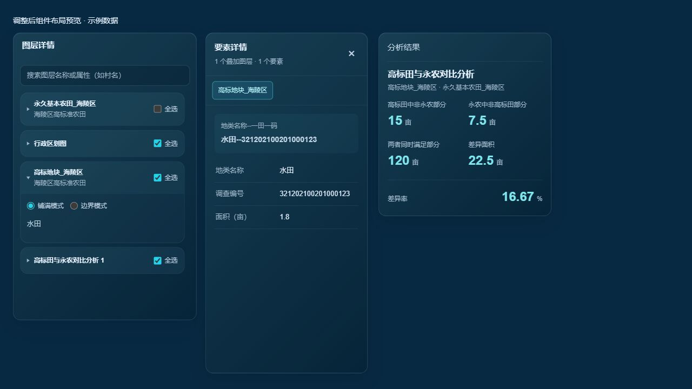
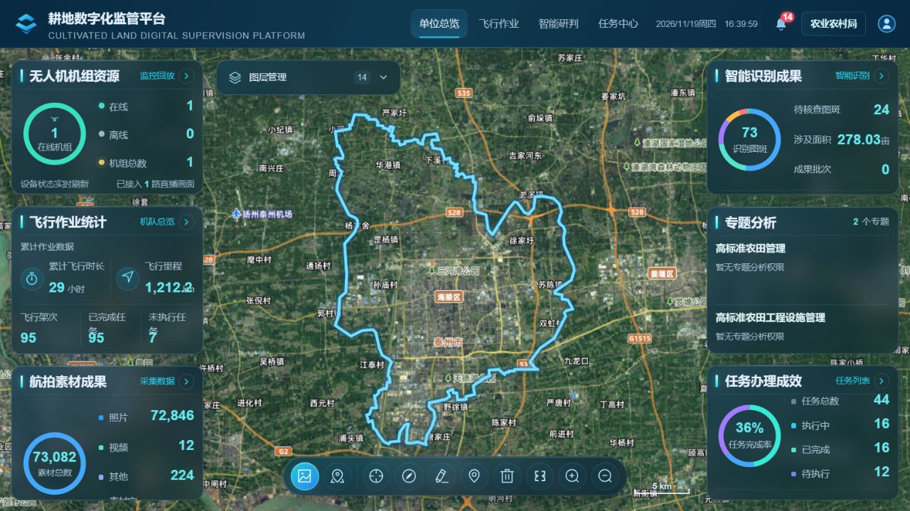
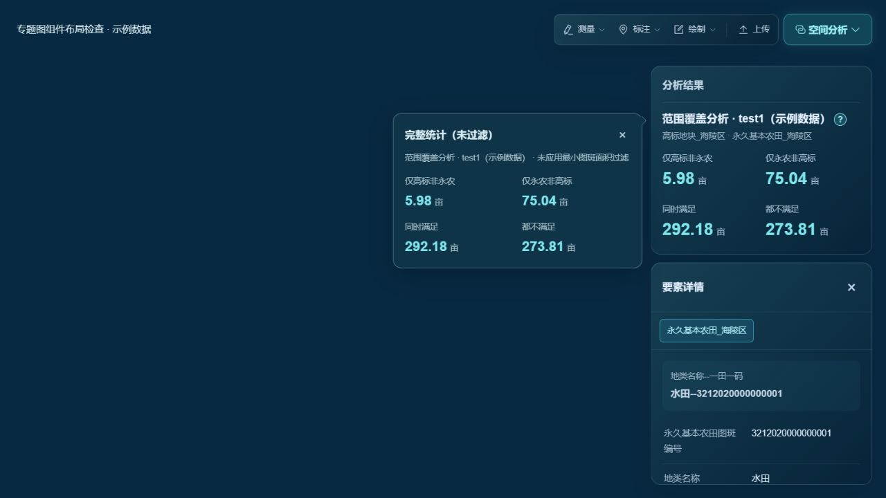
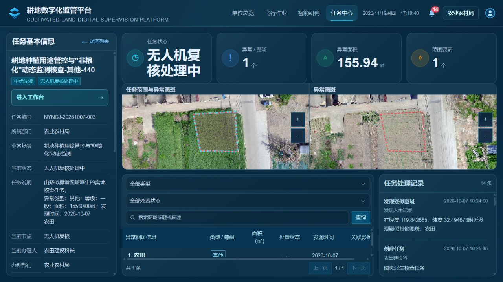
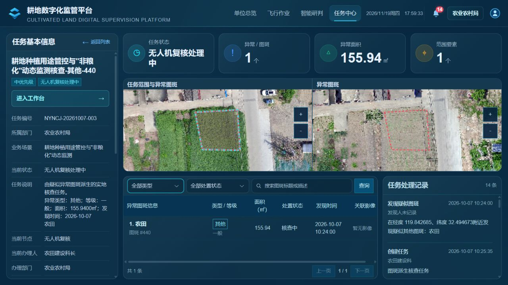

# 工作台图片与专题图层面板调整（2026-11-18）

- 无人机复核图片占满与遥感影像相同大小的视窗，三个视窗的底部说明高度一致。图片支持独立滚轮缩放、拖动平移、双击或按钮复位；拖动时才提示不参与地图联动。
- 所有工作台共用待办按钮取消数字，仅在存在其他待办时显示红点。
- 高标田专题的乡级、村级行政区划归入“行政区划图”，按乡镇展开村级选项。乡村可分别勾选、定位，每行提供独立裁切按钮，可多选范围；显示样式在该行展开设置。取消裁切保留显示，取消显示同步移出裁切范围。归属优先取区划代码或明确乡镇字段，缺少代码时用真实几何判断；无法确认的村保留为“其他村级区划”，不丢弃、不猜配。
- 图层详情按2026-11-19反馈恢复左右分栏：出现分析结果后，左栏为原始图层（发布、上传、绘制），右栏为结果图层，分别滚动；没有结果时单栏320px，有结果时扩展到560px，小屏按可用宽度收缩。移除发布及上传/绘制图层名称下方的描述小标题，保留图层名称12px粗体及组件主标题15px。分栏不重建图层组件，保留勾选、展开、颜色和显示模式。
- 每次新分析完成后取消旧业务图层、上传图层和旧结果的显示，保留当前结果及本次选择的行政边界。旧卡片保留，允许重新打开。行政区裁切完成也会隐藏此前分析结果与上传图层。
- 场景配置只保留背景影像，使用当前部门可访问服务列表中的所有影像选项。空间分析独立成栏，其余地图工具在另一栏。
- 地图图例可鼠标或键盘选择，按对应分类的真实几何高亮并定位；裁切状态使用裁切后的几何，上传和结果图层使用本机已有几何。
- 要素详情标题15px，恢复原有留白；按2026-11-19最新反馈，与分析结果共享右侧栏宽度（最小320px、最大560px并受视口限制），移除标题下方的叠加图层/要素数量；不再列出行政区图层。摘要显示“地类名称--一田一码”，永农取永久基本农田图斑编号，高标田取调查编号，不拿 OBJECTID 代替。
- 默认高标田统计只由高标田图层打开状态触发，永农单独打开不再触发；分析统计与区域统计继续使用各自结果。

验证：类型检查、生产构建通过。新增层级/多片区/洞、图片独立缩放平移、结果隔离、区划边界保留、图例高亮与裁切详情测试；已有裁切、区域统计、空间分析、覆盖分析、绘制加载、改色、图片匹配相关测试通过。

真实工作台 NYNCJ-20261007-003 已核对：三个视窗均约281.3×237.6px，通知无数字且显示红点。真实照片仅用于本地显示验证，本轮未上传附件、删除原附件或推进流程。

当前已授权账号进入专题页返回缺少 SPECIAL_ANALYSIS 权限，因此真实区划接口联调尚未验证。下图为恢复留白后的本地组件预览，使用示例数据。

2026-11-19：修复未过滤范围统计遇到后端零面积残片时整体失败。先校验原始分组数量、来源分类、几何及面积总和，再排除面积恰为0的残片；所有正面积碎斑均保留，不提高最小面积阈值。原始响应不被修改，负数、缺失面积、非数值、错误分类和不完整返回继续报错。已通过包含序号59零面积残片的三阶段覆盖回归、两栏无横向溢出及状态保留的组件界面验证、类型检查和构建。旧的失败分析记录需重新分析后更新。

后续修正：覆盖分析四类面积及两项包含重叠的汇总面积统一取经过完整性校验的后端分组汇总值，不再累加逐图斑舍入值作为统计。增加“单组舍入误差在允许范围内但四组合计误触发总面积校验”的回归；真实分组总面积超出上传范围仍会失败，并返回上传面积、四类合计、超出值、分阶段面积和投影信息，不能仅凭旧错误文字判定为后端问题。

栏标题后续修正：将“原始图层/结果图层”置于两列上方的独立标题行，居中、同高、透明背景；下方列表分别滚动，标题不再覆盖卡片。已验证单栏320px与双栏560px的切换。

完整统计弹窗全屏修正：已复现按钮处于展开状态、弹窗为display:block但不可见的情况；弹窗原先挂在body下，位于Fullscreen API的专题容器之外。现改为挂载到专题根容器（位于统计滚动区外），设置固定定位及2400层级，并提供真实触发元素作为虚拟锚点的contextElement，跟随滚动更新。已验证普通/全屏可见、键盘聚焦触发及点击固定/外部关闭，未改变统计计算逻辑。

2026-11-19后续修正：

- 首页自动绘制海陵区边界，取消农业农村局和场景聚焦状态的排除；显式选择九龙镇边界时仍切换至九龙镇。行政边界使用专题同款青色双描边，已发布矢量层复用专题的C5地类颜色、图式和渲染器，分类色块同步；影像不改色。
- 分析结果“都不满足”默认边界模式，其余分类默认铺满，保留之后手动切换的能力。上传按钮使用明确命名的UploadIcon并补“上传”文字。
- 完整统计的错误并非网络错误：第一轮输出再以WGS84输入第二轮时，后端重新投影/几何修复使高标分支输入从198770.3085变为198770.6139㎡、范围外分支从232568.402变为232568.2421㎡；四类与第二轮各自输入基本守恒，但旧前端只与首轮上传面积比较，错误触发0.05㎡上限。
- 现逐轮校验输入与输出；两轮输入转换差须控制在每分支2ppm（绝对下限0.05㎡）且投影一致，最终只继承经过此上限校验的实际正向漂移。保留后端统计原值，不缩放、不扣除碎斑。某一轮重复计面积、异常输入漂移或投影变化仍拒绝显示，不以其他分支少计面积抵消。
- 使用上述原始数值的三阶段回归已通过，原始上传面积431338.7107㎡和四类统计均不变；明显重复面积与分支增减相抵的错误仍被拦截。类型检查、生产构建、相关地图/统计回归通过。
- 已通过授权账号实测首页；账号当前缺少SPECIAL_ANALYSIS，未重新提交真实专题分析。下面的专题布局图使用真实组件和示例数据验证等宽、上传图标与问号弹窗。

2026-11-19紧凑布局及任务入口调整：

- 任务详情入口按后续澄清进一步收紧：后端成功返回当前任务、场景有效且当前用户具备工作台路由要求的任务权限之外，必须有属于当前登录用户的PROCESSING或COMPLETED真实工作流节点（复用myTaskWorkState）。仅可查看、仅为任务负责人/创建人、未来PENDING节点、SKIPPED节点或未参与的管理员均不显示入口；流程未加载/读取失败也不推断授权。入口只负责导航，工作台保持原有办理人与历史节点只读判断。已完成两种场景各6种任务状态及8种参与关系的渲染回归，类型检查通过；此前已实测NYNCJ-20261007-003从详情进入对应非粮化工作台。
- 地类名称、一田一码拆为两个独立高亮块，分别使用青绿与金黄色，字号保留14px。详情表移除这两个已展示的来源字段；其他业务属性继续保留，长编号及前导零不变，缺少业务编号时明确提示，不使用OBJECTID替代。
- 高标田图层详情单栏由320px收窄至300px，双栏由560px收窄至500px，原始/结果分栏及独立滚动保留；右侧统计/要素面板保持等宽，最小300px、最大480px，并由数字内容决定必要宽度。本地示例实测左右单栏均300px、图层双栏500px，双列无横向溢出。
- 权限允许/拒绝、两种任务场景各6个状态的详情渲染回归，以及永农/高标地块的身份字段去重回归通过；类型检查与生产构建通过。专题图组件预览使用示例数据。

2026-11-19继续压缩留白：要素详情标题上下内边距8px、左右12px，移除标题外边距并固定关闭按钮24px高度；地类名称和一田一码改为同行两格，内边距6px/8px、间距8px，字号继续14px、颜色及字段去重保留。300px示例面板实测标题约41px高，两格同一top、高约54px，长编号无截断。

任务详情的任务状态从全局数字KPI样式中单独限定20px/26px；异常图斑筛选栏改四列网格（两个下拉、搜索、查询），不换行，四个控件统一36px高。真实任务NYNCJ-20261007-003实测状态为20px，筛选控件在同一水平线上，整栏约49px高。类型检查、生产构建、要素字段渲染回归通过。

后续按反馈将地类名称格固定为63px（含边框），左右内边距6px，保证12px“地类名称”标签可完整容纳；一田一码格占剩余空间。上方示例图为固定63px之前的同行布局。

