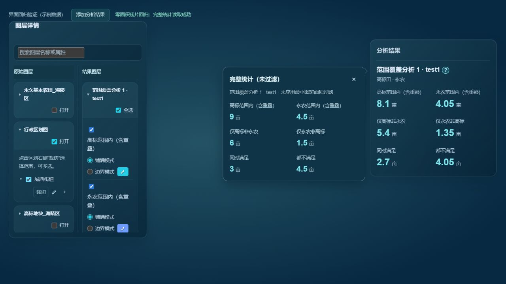

# 工作台图片与专题图层面板调整（2026-11-18）

- 无人机复核图片占满与遥感影像相同大小的视窗，三个视窗的底部说明高度一致。图片支持独立滚轮缩放、拖动平移、双击或按钮复位；拖动时才提示不参与地图联动。
- 所有工作台共用待办按钮取消数字，仅在存在其他待办时显示红点。
- 高标田专题的乡级、村级行政区划归入“行政区划图”，按乡镇展开村级选项。乡村可分别勾选、定位，每行提供独立裁切按钮，可多选范围；显示样式在该行展开设置。取消裁切保留显示，取消显示同步移出裁切范围。归属优先取区划代码或明确乡镇字段，缺少代码时用真实几何判断；无法确认的村保留为“其他村级区划”，不丢弃、不猜配。
- 图层详情按2026-11-19反馈恢复左右分栏：出现分析结果后，左栏为原始图层（发布、上传、绘制），右栏为结果图层，分别滚动；没有结果时单栏320px，有结果时扩展到560px，小屏按可用宽度收缩。移除发布及上传/绘制图层名称下方的描述小标题，保留图层名称12px粗体及组件主标题15px。分栏不重建图层组件，保留勾选、展开、颜色和显示模式。
- 每次新分析完成后取消旧业务图层、上传图层和旧结果的显示，保留当前结果及本次选择的行政边界。旧卡片保留，允许重新打开。行政区裁切完成也会隐藏此前分析结果与上传图层。
- 场景配置只保留背景影像，使用当前部门可访问服务列表中的所有影像选项。空间分析独立成栏，其余地图工具在另一栏。
- 地图图例可鼠标或键盘选择，按对应分类的真实几何高亮并定位；裁切状态使用裁切后的几何，上传和结果图层使用本机已有几何。
- 要素详情标题15px，恢复原有留白，宽度仍独立固定300px；不再列出行政区图层。摘要显示“地类名称--一田一码”，永农取永久基本农田图斑编号，高标田取调查编号，不拿 OBJECTID 代替。
- 默认高标田统计只由高标田图层打开状态触发，永农单独打开不再触发；分析统计与区域统计继续使用各自结果。

验证：类型检查、生产构建通过。新增层级/多片区/洞、图片独立缩放平移、结果隔离、区划边界保留、图例高亮与裁切详情测试；已有裁切、区域统计、空间分析、覆盖分析、绘制加载、改色、图片匹配相关测试通过。

真实工作台 NYNCJ-20261007-003 已核对：三个视窗均约281.3×237.6px，通知无数字且显示红点。真实照片仅用于本地显示验证，本轮未上传附件、删除原附件或推进流程。

当前已授权账号进入专题页返回缺少 SPECIAL_ANALYSIS 权限，因此真实区划接口联调尚未验证。下图为恢复留白后的本地组件预览，使用示例数据。

2026-11-19：修复未过滤范围统计遇到后端零面积残片时整体失败。先校验原始分组数量、来源分类、几何及面积总和，再排除面积恰为0的残片；所有正面积碎斑均保留，不提高最小面积阈值。原始响应不被修改，负数、缺失面积、非数值、错误分类和不完整返回继续报错。已通过包含序号59零面积残片的三阶段覆盖回归、两栏无横向溢出及状态保留的组件界面验证、类型检查和构建。旧的失败分析记录需重新分析后更新。

后续修正：覆盖分析四类面积及两项包含重叠的汇总面积统一取经过完整性校验的后端分组汇总值，不再累加逐图斑舍入值作为统计。增加“单组舍入误差在允许范围内但四组合计误触发总面积校验”的回归；真实分组总面积超出上传范围仍会失败，并返回上传面积、四类合计、超出值、分阶段面积和投影信息，不能仅凭旧错误文字判定为后端问题。

栏标题后续修正：将“原始图层/结果图层”置于两列上方的独立标题行，居中、同高、透明背景；下方列表分别滚动，标题不再覆盖卡片。已验证单栏320px与双栏560px的切换。

完整统计弹窗全屏修正：已复现按钮处于展开状态、弹窗为display:block但不可见的情况；弹窗原先挂在body下，位于Fullscreen API的专题容器之外。现改为挂载到专题根容器（位于统计滚动区外），设置固定定位及2400层级，并提供真实触发元素作为虚拟锚点的contextElement，跟随滚动更新。已验证普通/全屏可见、键盘聚焦触发及点击固定/外部关闭，未改变统计计算逻辑。

